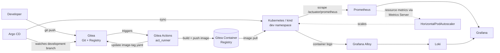
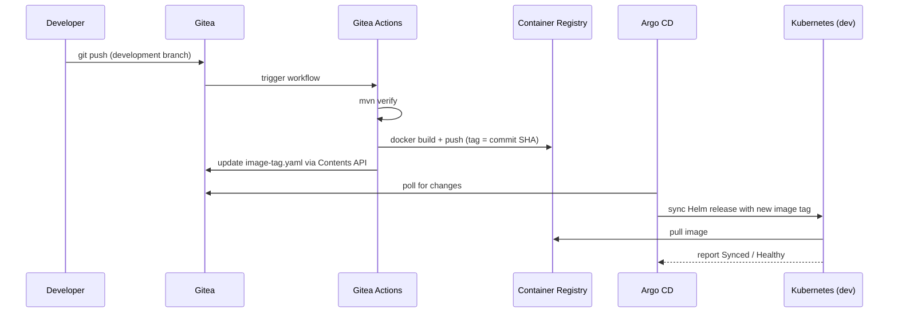

# Self-hosted CI/CD Pipeline thesis repo

This repository is the practical foundation for the MSc thesis project focused on a self-hosted CI/CD pipeline. The goal is to demonstrate how a team can achieve local, reproducible delivery automation with a Git server, a CI engine, a private container registry, a Kubernetes runtime, deployment automation, and observability tooling.

The project is designed to be both educational and practical: it contains a sample Spring Boot application, a local Docker-based infrastructure baseline, and a Kubernetes-ready deployment model that can be used to explain modern DevOps and GitOps concepts in a thesis context.

## Thesis objective

The major research objective is to show that a self-hosted delivery pipeline can:

- increase development workflow automation,
- reduce reliance on external cloud services,
- improve traceability and control over builds and deployments,
- provide a realistic local environment for experimenting with CI/CD processes,
- and expose system health, performance, and behavior through observability tooling.

The repository therefore combines three layers:

1. application code for a demo service,
2. local infrastructure for CI/CD and observability,
3. documentation and deployment steps for repeatable thesis use.

## Architecture



## CI/CD Delivery Flow



## Repository structure

- `apps/pipeline-pilot/` – Spring Boot demo app, Helm chart, Dockerfile, and traffic-test Job
- `infra/` – shared platform configuration for ingress-nginx, Gitea, Argo CD, and observability
- `scripts/` – bootstrap and runtime helper scripts
- `kind/` – local Kubernetes cluster definition
- `docs/thesis-demo-scenarios.md` – step-by-step experiments to run and record for the thesis
- `plan.txt` – original thesis plan and architecture notes
- `LICENSE` – project license


## Bootstrapping the developer toolchain

The installation scripts support Linux x86_64 and require Docker Engine or Docker
Desktop, `curl`, `tar`, and access to the local Docker daemon. The bootstrap script
installs Java 21, Maven, kind, kubectl, and Helm in `~/.local` without modifying
your shell configuration.

From the repository root:

```bash
bash scripts/bootstrap-local.sh
```

For Bash or Zsh, make the tools available in the current shell:

```bash
export PATH="$HOME/.local/jdk/bin:$HOME/.local/apache-maven/bin:$HOME/.local/bin:$PATH"
```

For Fish:

```fish
set -gx PATH "$HOME/.local/jdk/bin" "$HOME/.local/apache-maven/bin" "$HOME/.local/bin" $PATH
```

## Fresh local installation

Run the following scripts in order. Every Helm chart version is pinned to the
version validated by this repository.

```bash
bash scripts/create-kind-cluster.sh
bash scripts/install-ingress-nginx.sh
bash scripts/install-gitea.sh
```

Add these local host names before accessing Gitea or installing the Actions runner:

```text
127.0.0.1 gitea.local argocd.local grafana.local prometheus.local
```

On WSL, update both the WSL `/etc/hosts` file and the Windows hosts file so that
browser access resolves correctly. Then install the remaining platform services:

```bash
bash scripts/install-act-runner.sh
bash scripts/install-argocd.sh
bash scripts/install-observability.sh
```

Create a Gitea repository named `MSc-thesis` under `gitea_admin`, push the
`development` branch to it, and configure the Actions secrets below before applying
the Argo CD application:

- `REGISTRY_USERNAME` and `REGISTRY_PASSWORD`: Gitea package credentials
- `GIT_PUSH_TOKEN`: a Gitea token with repository write access, used to update the image tag

Create the `regcred` image-pull secret in the `dev` namespace with a Gitea token
that has `read:package` permission, then apply the GitOps application:

```bash
kubectl create secret docker-registry regcred --namespace dev \
  --docker-server=gitea.local \
  --docker-username=gitea_admin \
  --docker-password='<read-package-token>'
kubectl apply -f infra/argocd/application-pipeline-pilot.yaml
```

## Current platform state

The project is already running as a working self-hosted pipeline in the local kind cluster.
The current environment includes the following components:

- kind cluster with `mgmt` and `dev` namespaces
- ingress-nginx for local host routing
- Gitea as the Git server and package registry
- Gitea Actions runners for CI automation
- Argo CD for GitOps-driven deployment
- the Spring Boot app deployed into the `dev` namespace
- Metrics Server for Kubernetes resource metrics and HPA decisions
- Prometheus and Grafana for metrics collection and visualization
- Loki and Grafana Alloy for centralized Kubernetes log collection

The base setup commands used are:

```bash
./scripts/create-kind-cluster.sh
./scripts/install-ingress-nginx.sh
./scripts/install-gitea.sh
./scripts/install-act-runner.sh
./scripts/install-argocd.sh
./scripts/install-observability.sh
```

- `infra/ingress-nginx/` – notes on the kind-provider ingress-nginx manifest used
- `infra/gitea/values.yaml` – Helm values for `gitea-charts/gitea`, using SQLite
  and in-process cache/queue/session backends (no Postgres/Redis) to keep the
  local demo lightweight; Gitea Actions is enabled for CI.
- `infra/argocd/application-pipeline-pilot.yaml` – Argo CD `Application` that deploys
  the application from the `development` branch into the `dev` namespace.

Add `127.0.0.1 gitea.local` and `127.0.0.1 argocd.local` to `/etc/hosts`, then browse to
http://gitea.local and http://argocd.local.

- Gitea admin login: `gitea_admin` / `ChangeMe123!` (defined in `infra/gitea/values.yaml`)
- Argo CD admin password: `kubectl -n argocd get secret argocd-initial-admin-secret -o jsonpath="{.data.password}" | base64 -d`

### Observability

The observability stack runs in the `observability` namespace. Prometheus scrapes
`pipeline-pilot.dev.svc.cluster.local:80/actuator/prometheus`; Loki receives Kubernetes
container logs through Grafana Alloy; and Grafana provisions the `Pipeline Pilot Overview`
dashboard from `infra/observability/pipeline-pilot-dashboard.yaml`.

Add `127.0.0.1 grafana.local prometheus.local` to `/etc/hosts`, then browse to
http://grafana.local or http://prometheus.local. Grafana login: `admin` / `ChangeMe123!`.

Generate a short, repeatable in-cluster traffic sample for the dashboard with:

```bash
bash scripts/run-observability-traffic-test.sh
```

The default Job at `apps/pipeline-pilot/traffic-test/job.yaml` calls `/health`,
`/users`, and `/simulate-load` thirty times and emits one log line per iteration.
Metrics appear in Prometheus and the log lines appear in Grafana's `Development
Workload Logs` panel.

Configure an experiment through environment variables. `REQUESTS` controls the
number of iterations per worker; `CPU_MILLIS`, `IO_MILLIS`, and `COMPLEXITY` control
the `/simulate-load` request; `PAUSE_SECONDS` controls the pause between iterations;
and `WORKERS` controls how many pods run in parallel (each a separate Job
completion), so total requests issued = `WORKERS` × `REQUESTS`.

```bash
REQUESTS=120 CPU_MILLIS=500 IO_MILLIS=50 COMPLEXITY=20000 PAUSE_SECONDS=0 \
  bash scripts/run-observability-traffic-test.sh
```

To reliably trigger HPA scale-out, run enough concurrent load to push CPU
utilization above the 60% target for a sustained period:

```bash
WORKERS=8 REQUESTS=200 CPU_MILLIS=600 IO_MILLIS=25 COMPLEXITY=20000 PAUSE_SECONDS=0 \
  bash scripts/run-observability-traffic-test.sh
```

Watch `kubectl get hpa -n dev -w` or the `HPA Current and Desired Replicas`
Grafana panel while it runs. After the Job completes, replicas scale back down
once the HPA's stabilization window elapses.

### Alerting

`infra/observability/pipeline-pilot-alerts.yaml` defines a `PrometheusRule` picked
up automatically by the Prometheus Operator (label `release: monitoring`). It
covers:

- `PipelinePilotDown` – the Prometheus target is unreachable for 2 minutes
- `PipelinePilotHighLatency` – average HTTP latency exceeds 1s for 5 minutes
- `PipelinePilotHighCPUUtilization` – CPU exceeds 90% of requested CPU for 5
  minutes, i.e. close to the HPA's scaling ceiling
- `PipelinePilotDeploymentUnavailable` – available replicas stay below desired
  for 5 minutes
- `PipelinePilotContainerRestarting` – any container restart in the last 15
  minutes

Alerts are visible in Prometheus (`http://prometheus.local/alerts`) and
Alertmanager, and firing alerts also surface in Grafana's Alerting view. The
default Alertmanager route has no external notification channel configured
(local demo), so alerts are evidence of detection, not paging.

### Container registry

Gitea's built-in OCI container registry (Packages feature) is used instead of a
separate registry service - one less moving part, same auth/users. Images live
at `gitea.local/<owner>/<image>:<tag>`.

```bash
docker login gitea.local -u gitea_admin -p 'ChangeMe123!'
docker tag pipeline-pilot:latest gitea.local/gitea_admin/pipeline-pilot:latest
docker push gitea.local/gitea_admin/pipeline-pilot:latest
```

In-cluster pulls authenticate via a `regcred` `docker-registry` Secret (created
in the `mgmt` and `dev` namespaces from a `read:package`-scoped Gitea token),
referenced by the Helm chart's `imagePullSecrets` (see
`apps/pipeline-pilot/helm/pipeline-pilot/values.yaml`).

### CI: Gitea Actions

- `infra/act-runner/` – `gitea/act_runner` + a privileged `docker:dind`
  sidecar, deployed into `mgmt` via `scripts/install-act-runner.sh`. Jobs run
  in a slim `node:20-bookworm-slim` container (Maven/Docker CLI installed as
  workflow steps) via the runner's Docker connection to the sidecar.
- CoreDNS has a rewrite rule (`gitea.local` → `ingress-nginx-controller` in
  the `ingress-nginx` namespace) so `gitea.local` resolves the same way
  in-cluster (for the runner/checkout/registry) as it does on the host.
- Workflow: `.gitea/workflows/pipeline-pilot-ci.yml` - runs `mvn verify`, then
  builds and pushes the image to the Gitea container registry on every push
  touching `apps/pipeline-pilot/**`. Registry credentials are stored as
  repo-level Actions secrets (`REGISTRY_USERNAME` / `REGISTRY_PASSWORD`).
- Verified working end-to-end: `mvn verify` → `docker build` → image pushed to
  `gitea.local/gitea_admin/pipeline-pilot` (tags `latest` and the commit SHA).

### CD: Argo CD (GitOps)

- `infra/argocd/` – Argo CD installed via Helm into its own `argocd`
  namespace (`scripts/install-argocd.sh`), ingress at `argocd.local`, served
  plain HTTP like the rest of the stack.
- `infra/argocd/application-pipeline-pilot.yaml` – an `Application` watching
  `apps/pipeline-pilot/helm/pipeline-pilot` on the `development` branch,
  deployed to the `dev` namespace with automated sync, prune, and self-heal.
- Closed-loop GitOps: after a successful image push, the CI workflow bumps
  `apps/pipeline-pilot/helm/pipeline-pilot/image-tag.yaml` (a small
  values-override file merged on top of `values.yaml`) with the new image
  tag via Gitea's Contents API, and Argo CD picks up that commit
  automatically. That file's path is excluded from the workflow's trigger
  filter to avoid a build loop.
- containerd on the kind node needs `config_path = "/etc/containerd/certs.d"`
  (now in `kind/cluster-config.yaml`'s `containerdConfigPatches`) plus a
  `hosts.toml` for `gitea.local` (written by `scripts/install-gitea.sh`) so
  the kubelet can pull images from the registry over plain HTTP.
- Add `127.0.0.1 argocd.local` to `/etc/hosts` (WSL and Windows, see the
  Gitea section above), then browse to http://argocd.local. Get the initial
  admin password with:
  `kubectl -n argocd get secret argocd-initial-admin-secret -o jsonpath="{.data.password}" | base64 -d`

## Demo app endpoints

The Spring Boot service exposes the following API endpoints:

- `GET /health`
- `GET /users`
- `POST /orders`
- `GET /orders`
- `GET /simulate-load?cpuMillis=250&ioMillis=100&complexity=5000`
- `GET /actuator/prometheus`

These endpoints are useful for:

- app health validation,
- API behavior demonstration,
- load testing and resource profiling,
- and application metrics exposure for Prometheus scraping.

## Docker image workflow

Build the application image locally:

```bash
docker build -t pipeline-pilot:local ./apps/pipeline-pilot
```

For a manual registry test, authenticate and push to the Gitea registry:

```bash
docker login gitea.local -u gitea_admin
docker tag pipeline-pilot:local gitea.local/gitea_admin/pipeline-pilot:manual
docker push gitea.local/gitea_admin/pipeline-pilot:manual
```

Normal deployments should be performed through a Git push so Gitea Actions builds,
tags, and publishes the image before Argo CD synchronizes the Helm release.


## Completed implementation status

The repository already contains the implemented self-hosted delivery pipeline described in the thesis:

1. Local kind cluster for Kubernetes runtime
2. Gitea hosting and built-in package registry
3. Gitea Actions CI pipeline with tests, image build, and image push
4. Argo CD GitOps deployment for the application
5. Kubernetes deployment of the sample Spring Boot service
6. Local ingress and host routing for internal services

The remaining work is focused on extension and validation rather than initial setup, such as:

- load generation and autoscaling scenarios,
- observability validation and dashboards,
- final documentation refinement for the thesis narrative.

## Useful references

- Spring Boot: https://spring.io/projects/spring-boot
- Docker Desktop: https://www.docker.com/products/docker-desktop/
- Kubernetes: https://kubernetes.io/
- kind: https://kind.sigs.k8s.io/
- Helm: https://helm.sh/
- Prometheus: https://prometheus.io/
- Grafana: https://grafana.com/
- Loki: https://grafana.com/oss/loki/
- Gitea: https://about.gitea.com/
- Gitea Actions: https://docs.gitea.com/usage/actions/overview
- Gitea Runner: https://docs.gitea.com/runner/

## License

This project is licensed under the MIT License. See the `LICENSE` file for details.
